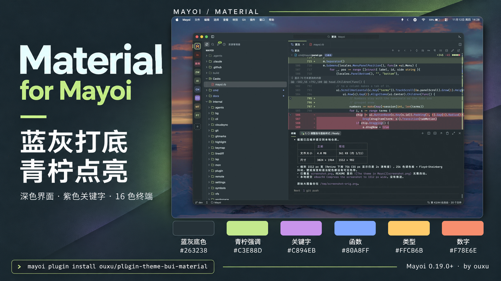

# Material for Mayoi

βui's Material theme, as Cursor shows it, for [Mayoi](https://github.com/sorrycc/Mayoi):
blue-grey chrome, a slate editor, lime accents, Material's purple keywords and a matching 16-color
terminal palette.



## Install

```sh
mayoi plugin install ouxu/plugin-theme-bui-material
```

Or paste the repository URL into **Plugins → Manage Plugins…** in the settings window.

Then pick **Material** in **View → Theme → Color Theme…**, or run
`view.theme.material.material` from the command palette. The theme is always dark, so the window's
title bar follows it whatever the Appearance is.

## Settings

The theme takes no settings. To go back, pick another theme; to remove it, run
`mayoi plugin remove material` or turn it off in **Settings → Plugins**.

## The theme file

`material.json` is Mayoi's palette format: the colors of the window on `colors`, the code's on
`syntax`, and the terminal's 16 colors on `ansi`, over the `dark` palette. Change a value there and
run `mayoi plugin dev .` to see it as you edit.

## Requires

Mayoi 0.19.0 or later, the first version whose plugins bring themes.
